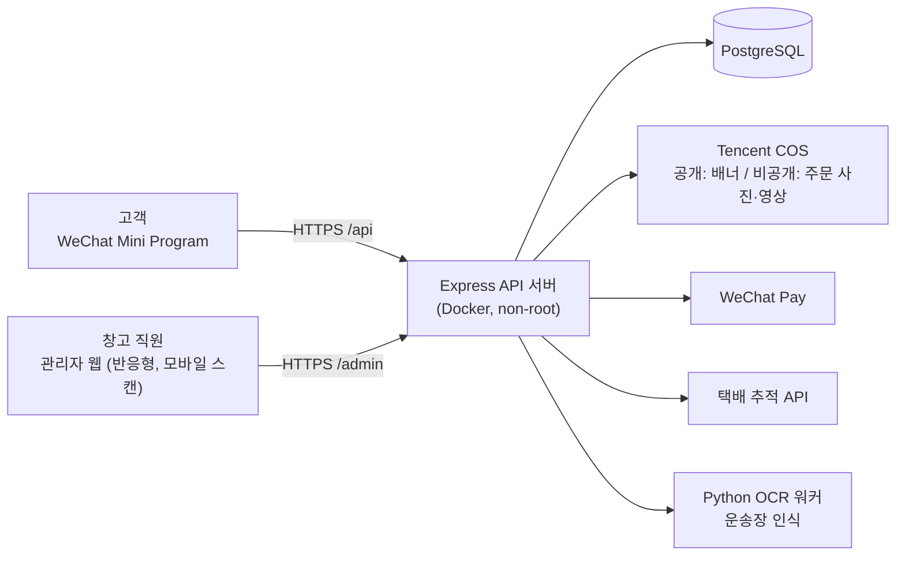
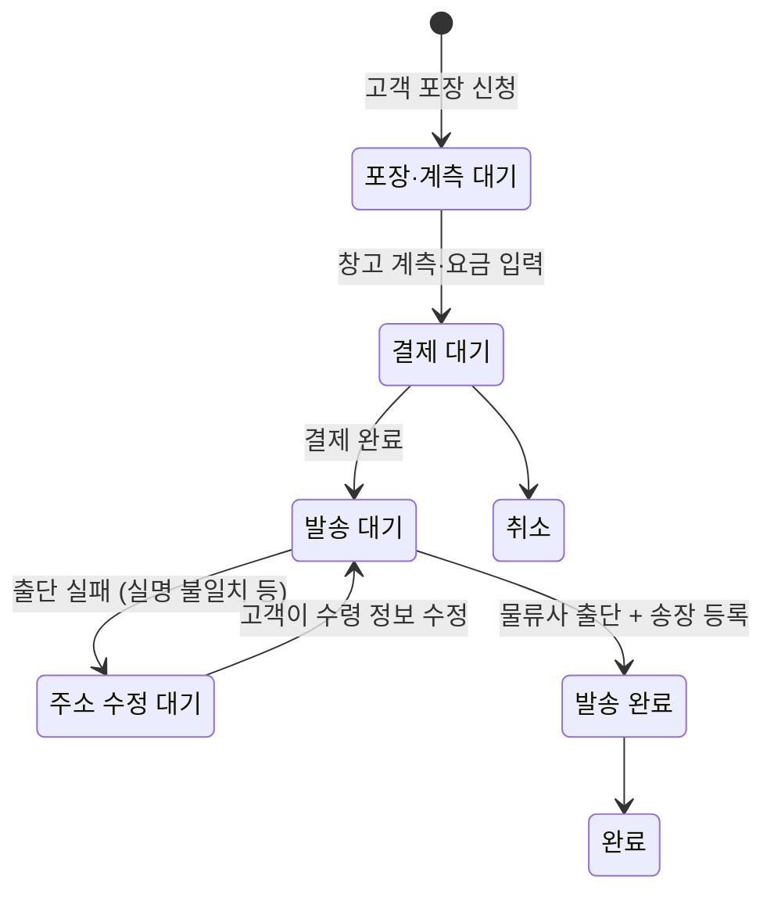
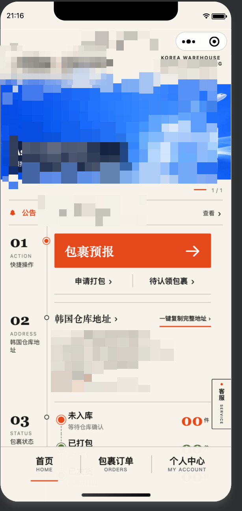
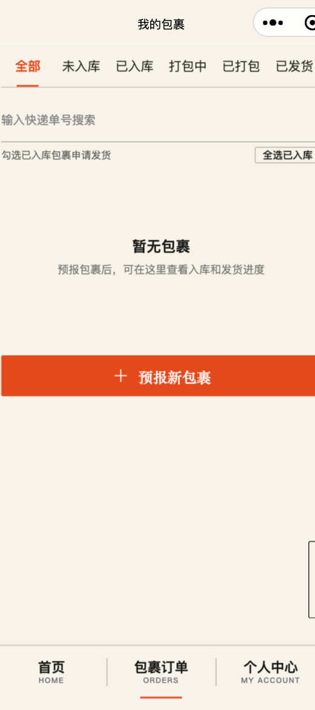

# 해외배송 대행 서비스 — 위챗 미니프로그램 + 관리자 웹

**기간** 2025.04 ~ 현재 (2026.10 정식 출시) · **역할** 1인 개발 (기획·백엔드·프론트·배포·운영)
**성과** 정식 출시 약 1개월 만에 누적 사용자 170명, 일 방문자 10~20명

`Node.js` `Express 5` `PostgreSQL` `WeChat Mini Program` `WeChat Pay` `Python(OCR)` `Docker` `Tencent Cloud (Lighthouse · COS)`

---

## 1. 배경 — 어떤 문제를 풀었나

한국 창고에서 중국 고객의 택배를 대신 받아 묶음 포장 후 중국으로 보내는 업무가 **위챗(WeChat) 메시지**로 하나하나 연락하며 운영되고 있었습니다.

- 고객이 어떤 택배를 보냈는지, 창고에 도착했는지 매번 위챗으로 묻고 답함
- 무게·요금 안내, 입금 확인, 송장 번호 전달을 사람이 하나하나 처리
- 중국 물류사 출단 시 실명·신분증 불일치로 발송이 막히면 원인 추적이 어려움

→ 고객은 **미니프로그램**으로 셀프 처리하고, 창고 직원은 **관리자 웹**에서 스캔·계측·발송만 하도록 전 과정을 시스템화했습니다.

## 2. 시스템 구성

## 3. 업무 흐름과 주문 상태 설계

**포인트** — 출단 실패를 "에러"가 아니라 **하나의 정식 상태**로 정의했습니다. 실패 사유(실명 불일치, 신분증 오류, 번호 실명 초과 등)를 기록하고 고객에게 알림을 보내, 고객이 수정하면 자동으로 발송 대기로 돌아갑니다. 직원이 개별 연락할 필요가 없어졌습니다.

## 4. 기술적으로 고민한 부분

### ① 결제 — 중복 결제와 "확인 중" 고착 막기
- **문제**: 네트워크 재시도로 같은 주문에 결제가 두 번 생성될 수 있고, 결제창을 닫은 채 만료되면 주문이 계속 "확인 중"에 멈춰 다시 결제할 수 없었음
- **해결**
  - 결제 요청마다 **멱등 키(Idempotency Key)** 를 받아, 같은 키는 같은 결과를 반환하고 다른 주문에 재사용되면 거부
  - 결제 상태를 `대기 → 성공 / 실패 / 종료 / 검토 필요`로 나눠 관리하고, 만료·종료된 결제 건은 **닫은 뒤 새로 결제** 가능하게 처리
  - **결제 대사(reconcile) 스크립트**로 WeChat Pay 측 상태와 DB를 대조해 누락 건 점검

### ② 운영 중인 DB를 안전하게 확장하기
- 출시 전후로 분할 출고, 합포장 제한, 창고 로케이션, 통관, 고객센터, 배송 추적 등 기능이 계속 추가됨
- 기능마다 **SQL 마이그레이션 파일(총 25건)** 과 실행 스크립트를 분리하고, 실행 전 대상 DB 이름을 검증해 **로컬 스크립트가 운영 DB에 적용되는 사고를 차단**

### ③ 보안
- 관리자 비밀번호 `scrypt` 해시 저장, HttpOnly 쿠키 세션 12시간 만료, 초기 관리자 계정은 환경변수로만 생성
- 주문 사진·영상은 **비공개 COS**에 저장하고 권한 확인 후에만 접근
- API 컨테이너는 non-root 사용자, 로컬 포트에만 바인딩, DB는 내부 네트워크에만 노출

### ④ 창고 현장 효율화
- 관리자 웹은 모바일에서도 쓰도록 반응형으로 만들고, 브라우저 카메라로 **바코드 스캔 입고**
- 주인 없는 택배는 **Python OCR 워커**로 운송장 이미지에서 수령인 정보를 읽어 회원과 매칭

## 5. 테스트와 문서화
- `node:test` 기반 단위·통합 테스트 (결제, 보안 등 별도 스위트)
- `docs/`에 아키텍처, API 맵, DB 맵, 의사결정 기록(DECISIONS), 배포 문서 유지

## 6. 화면

> 개인정보는 마스킹 처리했습니다.

| 고객: 홈 | 고객: 내 소포 | 고객: 주문/결제 | 관리자: 스캔 입고 |
|---|---|---|---|
|  |  |  |  |

## 7. 회고
- **잘한 점**: 예외 상황을 상태로 모델링하니 직원의 수동 연락이 줄고 이력 추적이 쉬워졌다.
- **배운 점**: 결제처럼 외부 시스템과 엮인 기능은 "성공/실패" 두 가지가 아니라 "모름(검토 필요)" 상태까지 설계해야 한다.
- **다음 개선**: 결제·발송 지표 대시보드, 알림 실패 재시도 큐 고도화.
