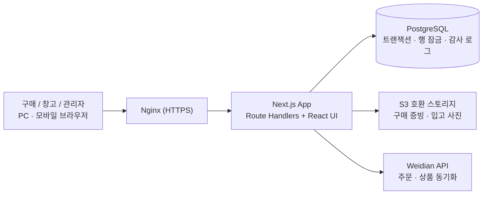
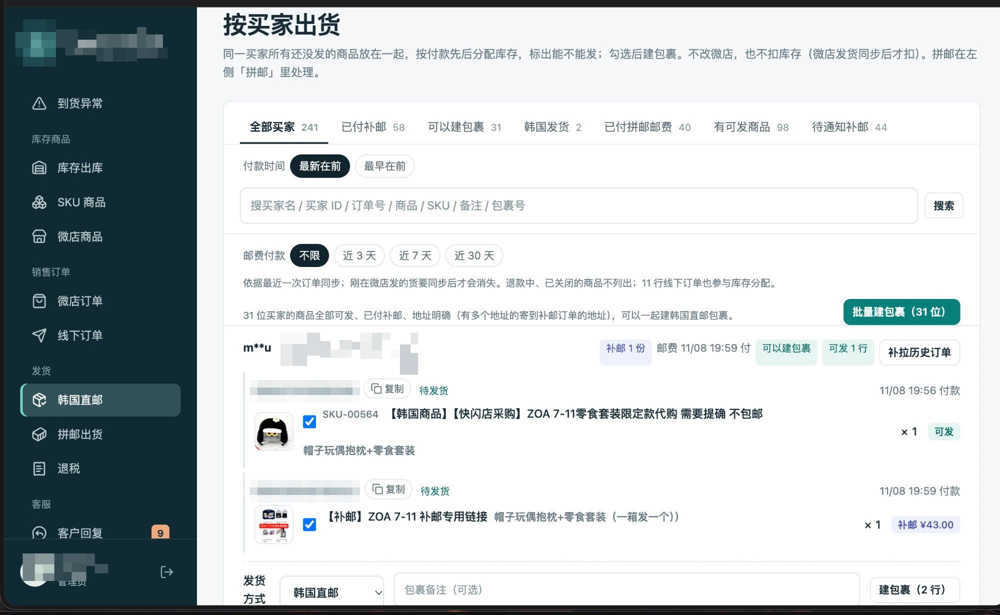
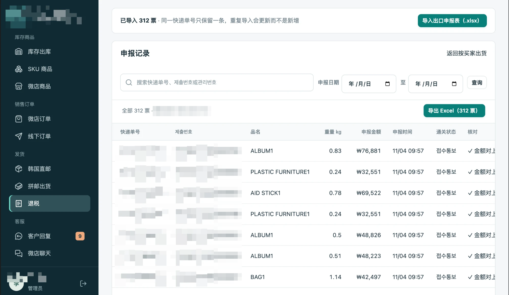

# 구매·입고·출고 관리 ERP

**기간** 2026.09 ~ 현재 · **역할** 1인 개발 (요구사항 정리·설계·개발·배포) · **상태** 한국 내 구매·창고 팀 실무 사용 중

`TypeScript` `Next.js 16` `React 19` `PostgreSQL` `Zod` `S3 호환 스토리지` `ZXing(바코드)` `Nginx`

---

## 1. 배경 — 어떤 문제를 풀었나

한국 상품을 중국 온라인 쇼핑몰 **微店(Weidian)** 에서 판매하는 업무는 주문·발송·상품 관리를 모두 Weidian 관리 화면에서 처리하고, 구매·입고 상황은 위챗(WeChat) 메시지로 주고받고 있었습니다.

- **발송이 번거로움** — Weidian 화면에서는 주문별 출고·송장 처리가 불편하고, 한국 창고의 실제 입고·재고와 연결되지 않음
- **세무·환급 자료 정리가 어려움** — 판매·발송 데이터를 신고에 필요한 형태로 모으려면 매번 수작업으로 가공
- **상품 등록·가격 비교의 비효율** — AI로 상품을 대량 등록하고 여러 구매처 가격을 비교하는 흐름이 Weidian 화면 안에서 계속 오가야 해서 느림
- **구매·입고 수량 관리** — "100개 샀는데 60개만 왔다"일 때 나머지가 배송 중인지 부족인지 구분이 안 되고, 부족·파손 처리 이력이 남지 않음

→ **Weidian 공식 Open API로 ERP와 연결**해, 주문·상품 데이터를 ERP로 가져오고 구매·입고·재고·출고·환급 자료까지 대부분의 작업을 ERP에서 처리하도록 했습니다. 데이터는 ERP에 쌓이므로 필요한 형식으로 저장·내보내기가 쉬워졌습니다.

## 2. 핵심 규칙 — 수량을 하나의 공식으로 정의

> **미입고 = 구매 수량 − 정상 입고 − 정산된 차이**

| 상황 | 처리 |
|---|---|
| 100개 구매, 먼저 60개 도착 | 정상 분할 입고. 나머지 40은 "도착 대기"이고 부족으로 자동 처리하지 않음 |
| 98개 도착, 2개 부족 확인 | 정상 입고 98 + 부족 예외 2 |
| 부족 2개 → 환불/손실 확정 | 정산된 차이 2 → 미입고 0, 주문 "정산 완료". 원 구매 금액은 수정하지 않고 환불액은 예외 기록에 보존 |
| 부족 2개 → 보충발송 | 예외는 "보충 대기" 유지, 창고에서 "보충 연결" 입고 시 자동 종료 (보충도 분할 도착 가능) |

이 규칙을 **도메인 로직 + 단위 테스트**로 고정해, 기능이 늘어나도 수량 계산이 흔들리지 않게 했습니다.

## 3. 시스템 구성

## 4. 기술적으로 고민한 부분

### ① 동시 입고에서 초과 입고 막기
- **문제**: 두 직원이 같은 구매 건을 동시에 입고 처리하면 둘 다 "남은 수량 40"을 보고 각각 40을 등록 → 80 입고
- **해결**: 입고 트랜잭션 안에서 구매 행을 `SELECT … FOR UPDATE`로 잠그고 남은 수량을 다시 계산한 뒤 저장. 부족·파손으로 이미 잡힌 수량은 일반 입고에 다시 쓸 수 없게 검증

### ② 중복 제출 방지 (멱등성)
- 모바일 현장에서 네트워크가 끊겨 같은 버튼을 다시 누르는 경우가 많음
- 구매·입고 요청에 **멱등 키**를 붙여, 같은 요청은 한 번만 반영
- 첨부파일은 구매 건 저장 후 별도로 업로드 → 업로드가 실패해도 구매 건이 중복 생성되지 않고, 상세 화면에서 다시 첨부

### ③ 역할 기반 권한과 감사
| 기능 | 관리자 | 구매 | 창고 |
|---|---|---|---|
| 구매 조회 | 전체 | 본인 건 | 전체 (**금액 숨김**) |
| 구매 등록 | ✅ | ✅ | ❌ |
| 입고·사진 등록 | ✅ | ❌ | ✅ |
| 예외 처리 | 전체 | 본인 건 | ❌ |
| 구매 증빙 | 전체 | 본인 건 | 접근 불가 |

- 구매·입고는 등록 후 임의 수정/삭제 경로를 두지 않고, 주요 쓰기 작업은 **감사 로그**로 추적
- 계정은 터미널에서만 생성(비밀번호 비노출), 공개 회원가입 없음

### ④ 파일 업로드
- 확장자가 아니라 **파일 헤더(매직 바이트)** 로 JPEG/PNG/WebP/PDF 검증
- 사진은 브라우저에서 용도별로 리사이즈·압축(현장 사진 1600px, 증빙 2400px), 세금계산서·이체 내역 등은 원본 보존
- 파일 열람 시 로그인·구매 건 권한 확인 후 **120초짜리 presigned URL** 발급

### ⑤ Weidian Open API 연동
- **토큰 관리**: 서버에서만 액세스 토큰을 발급받고, 만료 5분 전 자동 갱신. 토큰 캐시는 DB에 **AES-256-GCM 암호화** 저장, 트랜잭션 락으로 여러 프로세스가 동시에 재발급하지 않도록 제어
- **외부 API 한도 보호**: 실패 시 5분 쿨다운, 하루 발급 횟수 상한, 인증 만료 오류일 때만 1회 재시도 → 일일 호출 한도 초과·연쇄 실패 방지
- 주문 자동 동기화, 상품 가져오기와 ERP SKU 매핑(실물·추가 배송비·국내 재고·무시 구분), 상품·옵션별 이미지 동기화, Weidian 푸시 메시지 수신

### ⑥ 업무 범위 확장
- 입고 → 재고 → 출고·배송 → 통관 신고 자료 → **환급(退税) 자료 내보내기**까지 단계적으로 확장 (DB 마이그레이션 47건)
- 환급 자료는 날짜별 하나은행 고시 환율을 자동으로 가져와 적용하고, 정해진 엑셀 양식으로 내보내기
- 모바일 카메라 바코드 스캔(ZXing), HTTPS 환경에서 현장 촬영

## 5. 테스트
- 도메인 규칙, 재고 출고, 배송, 환불 리포트, Weidian 연동 등 **모듈별 단위 테스트**
- 별도 개발 DB에서만 실행되는 통합 테스트 (운영 DB 오적용 방지 가드)
- `typecheck` + `build`를 배포 전 필수 단계로 운영

## 6. 화면

> 구매자 정보·주문번호·송장번호·신고번호·합계 금액은 마스킹 처리했습니다.

**구매자별 출고** — 같은 구매자의 미발송 상품을 묶고, 결제 순서대로 재고를 배분해 발송 가능 여부를 표시. 선택 후 한 번에 소포 생성 (Weidian 주문 + 오프라인 주문 통합)

**환급(退税) 신고 기록** — 수출신고 엑셀을 가져오면 같은 송장번호는 갱신(중복 생성 없음), 신고 금액을 대조하고 기간별로 엑셀 내보내기

## 7. 회고
- **잘한 점**: 업무 규칙을 공식과 표로 먼저 합의하고 구현해, 현장과의 커뮤니케이션 비용이 크게 줄었다.
- **배운 점**: "정정 기능"을 쉽게 열어주면 데이터 신뢰도가 떨어진다. 수정 대신 이력을 쌓는 구조가 업무 시스템에 맞다.
- **다음 개선**: 정정 워크플로(승인 기반), 재고 리포트 고도화.
